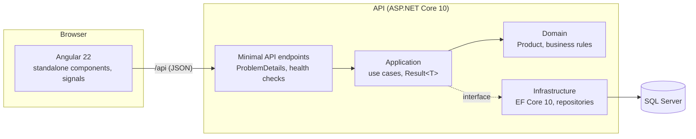

# ERP Lite

[](https://github.com/Esouna/erp-lite/actions/workflows/ci.yml)


A small stock and invoicing ERP, built the way I build business systems in production:
an **ASP.NET Core 10 API** with Clean Architecture, an **Angular** front end, **SQL Server**,
real integration tests and a one-command Docker setup. All data is fake.

> **Status: in progress.** The first slice (products and stock movements) works end to end.
> Customers, invoices, authentication and Azure deployment are next (see [Roadmap](#roadmap)).

## Run it

**Everything in Docker** (needs Docker Desktop):

```bash
docker compose up --build
```

Then open <http://localhost:8080>. The database is created and filled with demo products on first start.

**Local development** (needs the .NET 10 SDK, Node 22.12+, and SQL Server LocalDB on Windows):

```bash
dotnet run --project src/ErpLite.Api --launch-profile http   # API on http://localhost:5080
cd client && npm install && npm start                         # UI on http://localhost:4200
```

The Angular dev server forwards `/api` to the API (`client/proxy.conf.json`), so the front end never hardcodes an API address.
OpenAPI document in development: <http://localhost:5080/openapi/v1.json>.

## Architecture



| Project | Responsibility | Depends on |
|---|---|---|
| `ErpLite.Domain` | Entities and business rules. No framework code. | nothing |
| `ErpLite.Application` | Use cases, DTOs, repository interfaces | Domain |
| `ErpLite.Infrastructure` | EF Core `DbContext`, mappings, migrations, repositories | Application |
| `ErpLite.Api` | HTTP endpoints, error handling, configuration | Application, Infrastructure |
| `client/` | Angular app | the API contract only |

## Design decisions

- **Business rules live in the domain.** `Product` can't reach an invalid state: SKU required and normalized, price ≥ 0, stock never negative, no stock issued for an inactive product. The database repeats the critical rules as `CHECK` constraints, as a second line of defense.
- **Expected errors are values, not exceptions.** Use cases return `Result<T>` (not found / conflict / validation), and the API maps them to [RFC 9457 ProblemDetails](https://www.rfc-editor.org/rfc/rfc9457) with the right status code (404 / 409 / 400). The Angular client shows the `title` field as-is.
- **Concurrency is handled.** `RowVersion` (SQL Server `rowversion`) makes two users editing the same product produce a 409, not a silent overwrite.
- **Search is safe and index-friendly.** User input is escaped before going into `LIKE`, and SKU search is a prefix match, so it can use the unique index.
- **Migrations never run by surprise.** `Database:MigrateOnStartup` is off by default. It's on in local development and the Docker demo only. A real deployment applies a reviewed SQL script.
- **Supply-chain hygiene.** Central package management pins every NuGet version in one file. Known-vulnerable packages fail the build (`NuGetAudit`), which caught a transitive `System.Security.Cryptography.Pkcs` issue that's now pinned to a fixed version. Warnings are errors, and nullable reference types are on.
- **Containers run as non-root** (official ASP.NET image user, unprivileged nginx).

## Tests

```bash
dotnet test ErpLite.slnx     # domain unit tests + API integration tests
cd client && npx ng test     # Angular unit tests (Vitest)
```

- **Domain tests** (xUnit): the business rules of `Product`.
- **API integration tests** (xUnit + `WebApplicationFactory`): the real API in memory against a real SQL Server.
  By default a SQL Server 2022 container is started with [Testcontainers](https://testcontainers.com/).
  Without Docker, set `ERPLITE_TEST_CONNECTION` (for example `Server=(localdb)\MSSQLLocalDB;Trusted_Connection=True`): a throw-away database is created and dropped for the run.
- **Angular tests** (Vitest): API client, error mapping, form validation.

CI runs all of them on every push and pull request, then builds the Docker images.

## Roadmap

- [x] Products and stock movements (API, UI, tests, Docker, CI)
- [ ] Customers
- [ ] Invoices with lines, totals and VAT; stock issued on invoice validation
- [ ] Authentication: JWT between Angular and the API, role-based permissions
- [ ] Stock movement history (audit trail)
- [ ] Deployment to Azure App Service + Azure SQL, with a public demo login

## License

[MIT](LICENSE)
